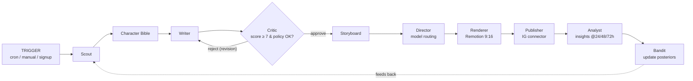

# Agent Workflow

The supervisor loop. Every hop is logged to `agent_steps` and shown in Mission Control.

**Reasoning agents** (call an LLM) are shown in bold; the rest are deterministic
services. Each role owns exactly one artifact — see `12-agent-roles.md` for the
no-duplication guarantee.

**Loop control.** The Critic ↔ Writer loop is capped at `MAX_REWRITES = 3` (see `lib/agent/pipeline.ts`). After the cap the episode is marked `failed` rather than shipped.

**Roles & models.**
| Step | Model | Notes |
|---|---|---|
| Scout | `deepseek-chat` | fresh angles/sounds/keywords for the format |
| Writer | `deepseek-chat` | hook → beats → cliffhanger + shot prompts (JSON) |
| Critic | `deepseek-reasoner` | 0–10 score + policy violations; gates shipping |
| Translate | `deepseek-chat` | EN script → CN captions |

**Critic gate.** Passes only if `score ≥ 7` **and** `violations.length === 0`. Policy rules live in `lib/agent/prompts.ts` (`POLICY_RULES`): original IP only, no real-person likeness, AI disclosure, no gore/hate/self-harm, no misinformation.

**Failure handling.** A single shot's video provider failing falls through to the next provider and finally to the Remotion slideshow, so one bad API call never kills an episode (`lib/video/providers.ts`).

**Trace.** `runPipeline` returns `AgentStep[]`; the worker persists them via `lib/store.ts` and the `/mission-control` page renders the trace.
